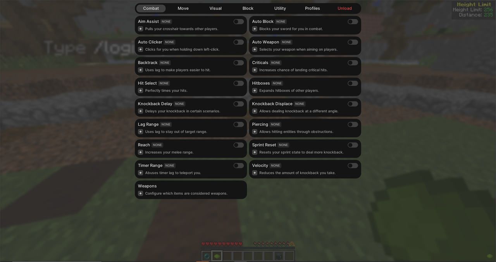

<p align="center">
  
  <br>
  <font size="6"><b>Open Slinky</b></font>
  <br>
  <font size="3">by Skid Solutions</font>
</p>

---

<p align="center">
  <a href="https://discord.gg/AEwatvnvSf">https://discord.gg/AEwatvnvSf</a>
</p>

<p align="center">
  
  
  
  
</p>

---

<p align="center">
  
</p>

---

## Supported clients (Minecraft 1.8.9)

| Client | Names the game uses | Payload used |
|---|---|---|
| Vanilla (Mojang launcher) | notch (`ave`) | official |
| OptiFine (standalone) | notch (`ave`) | official |
| Lunar Client | notch (`ave`) | official |
| Badlion Client | notch (`ave`) | official |
| Forge (and OptiFine on Forge) | SRG (`func_71410_x`) | srg |
| MCP/dev environment | MCP (`getMinecraft`) | named |

The loader inspects the running JVM and chooses the payload automatically. Check
`%TEMP%\slinky-<pid>\slinky-native.log` - it shows the detected namespace, e.g.
`detected Minecraft 1.8.9 with official names (class ave, ...)`.

## How to build

Prerequisites: Visual Studio 2019/2022 (or Build Tools) with **Desktop development with C++**, and CMake 3.15+.
No Java/Gradle is needed - the three payload jars are prebuilt in `SlinkyNative/payload`.

```powershell
powershell -ExecutionPolicy Bypass -File .\build.ps1
```

Output: `dist\Slinky.exe` + `dist\SlinkyNative.dll` (keep them in the same folder).
Manual build: `cmake -S . -B build -A x64` then `cmake --build build --config Release`.

Rebuilding the Java client (`SlinkyClient`) with Gradle (JDK 17) only produces the *named* jar; see CHANGES.md.
